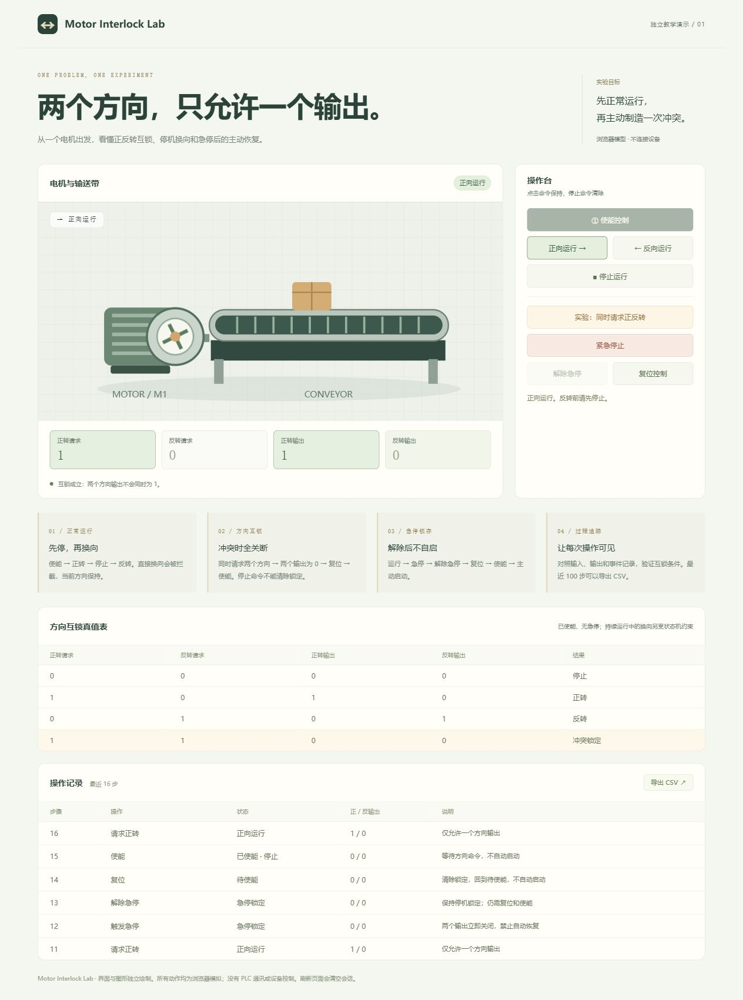
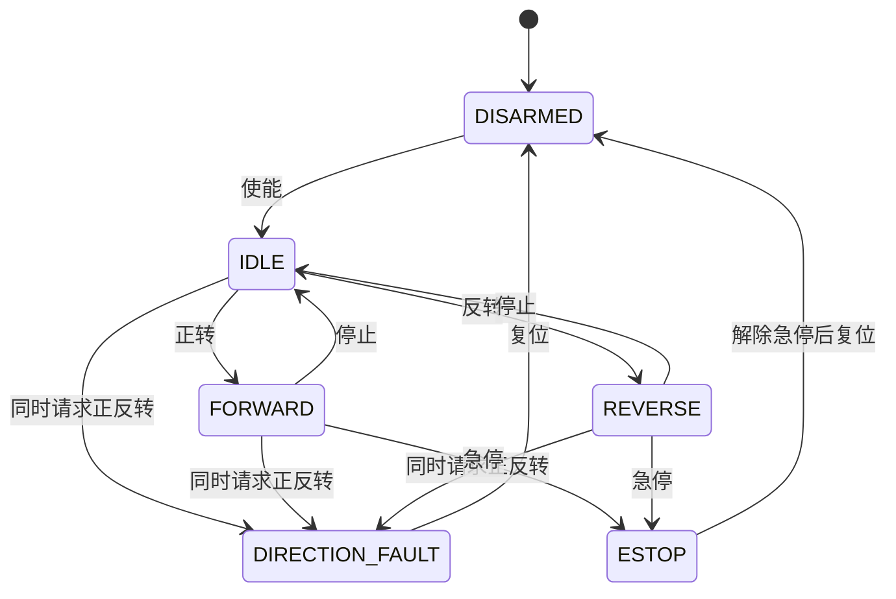

# Motor Interlock Lab｜电机正反转互锁实验

[](https://github.com/ton242678-glitch/motor-interlock-lab/actions/workflows/ci.yml)

### [▶ 在线体验电机互锁实验](https://ton242678-glitch.github.io/motor-interlock-lab/)

一个聚焦单个控制问题的自动化教学作品：**如何让电机正转、反转始终互斥，并在方向冲突和急停后要求主动恢复。**

[项目仓库](https://github.com/ton242678-glitch/motor-interlock-lab) · [功能拆解](docs/功能拆解.md) · [MIT 许可](LICENSE)

无需 PLC、触摸屏或前端依赖。项目使用纯 JavaScript 实现控制模型，配有自绘电机与输送带示意图，可在浏览器中直接操作。



## 只讲清一个问题

| 小实验 | 操作 | 应观察的结果 |
| --- | --- | --- |
| 正常运行与换向 | 使能 → 正转 → 停止 → 反转 | 一次只有一个方向输出；直接换向被拦截，原方向保持 |
| 方向冲突 | 同时请求正反转 | 两个输出为 0；故障锁定，复位后需重新使能 |
| 急停与恢复 | 运行 → 急停 → 解除 → 复位 → 使能 | 解除急停和复位均不会自动启动 |
| 记录与追踪 | 查看输入、输出和事件 → 导出 CSV | 每一步状态和输出都可核对；保留最近 100 步 |

这四组实验进一步拆成 **12 个小功能**，输入、输出、异常分支和验收方法见 [功能拆解](docs/功能拆解.md)。

## 运行

演示使用普通本地脚本，提供直接双击根目录 `index.html` 的入口，无需安装软件包或登录。本次浏览器实测通过下述本地 HTTP 服务进行；未实测浏览器的 `file://` 打开方式。

使用本地服务（Node.js 18+）：

```bash
git clone https://github.com/ton242678-glitch/motor-interlock-lab.git
cd motor-interlock-lab
npm start
# http://127.0.0.1:4174
```

端口占用时可在 PowerShell 执行 `$env:PORT=4175; npm start`。本地服务只监听回环地址，只提供四个演示文件。

## 控制规则

```text
已使能 且 无急停 且 无方向冲突
    正转请求=1，反转请求=0 → 正转输出=1
    正转请求=0，反转请求=1 → 反转输出=1
    正转请求=1，反转请求=1 → 两个输出=0，故障锁定
其他情况 → 两个输出=0
```

正在运行时，换向还受状态机约束：必须先停止，再发出相反方向命令。这里的“停止”指模拟输出已关闭，没有模拟惯性、转速反馈或实际停稳时间。



急停在所有状态下都可触发，图中省略部分重复箭头。解除急停后仍保持 `ESTOP`，复位后回到 `DISARMED`，重新使能后回到 `IDLE`；最后仍需主动发出方向命令。

## 代码拆分

```text
controller.js                 纯控制模型：方向互锁、状态机、日志与 CSV
app.js                        界面绑定：按钮、输入输出指示、事件表格
index.html / style.css        独立界面和自绘 SVG
tests/controller.test.cjs     控制规则与异常恢复测试
tools/serve.cjs               本机预览，只提供四个演示文件
tools/build.cjs               构建静态网站
docs/功能拆解.md              12 个小功能的输入、流程、异常、验收
docs/资源与许可.md            界面资源与开源许可说明
.github/workflows/            自动检查与手动 Pages 发布
```

控制模型可以脱离网页单独使用：

```js
const { Controller } = require('./controller.js');
const motor = new Controller();
motor.enable();
motor.request(true, false); // 正转
console.log(motor.outputs); // { forward: true, reverse: false }
motor.stop();
motor.request(false, true); // 反转
motor.emergencyStop();
console.log(motor.outputs); // { forward: false, reverse: false }
```

## 验证

```bash
npm test
npm run build
```

测试覆盖完整布尔输入真值表、未使能启动拦截、直接换向、冲突锁定、各状态急停、解除后的主动恢复、非法输入、记录隔离、CSV、日志上限，以及 4500 步混合操作序列下的输出互斥。

本地结果见 [验证记录](docs/验证记录.md)。网页中所有设备动作均为模拟，没有 PLC 通讯、实际电机控制、真实转速反馈或安全认证。

## 在线展示与部署

在仓库 Settings → Pages 中将 Source 设为 GitHub Actions，然后运行 Actions → Publish independent demo。流程先测试，再将 `dist/` 发布为静态网页。不需要运行 `npm install`。

## 许可

本项目代码、文档与自绘 SVG 采用 [MIT](LICENSE) 许可。资源说明见 [资源与许可](docs/资源与许可.md)。
